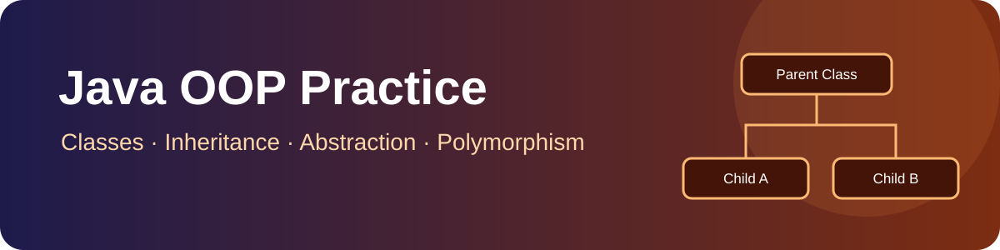

# Java OOP Practice

<p align="center"></p>

<p align="center"><strong>Java examples for learning object-oriented programming and small console applications.</strong></p>

## Concepts Used

| Concept | Where it appears | What it demonstrates |
|---|---|---|
| Classes and objects | All example files | Defining classes and creating object instances |
| Constructors | `PaymentSystem.java` | Initialising payment objects and validating constructor input |
| Encapsulation | `PaymentSystem.java` | Keeping the amount field protected and exposing behaviour through methods |
| Inheritance | `Payment.java`, `PaymentSystem.java`, `Uber.java` | Creating specialised payment and ride classes from parent classes |
| Method overriding | `Payment.java`, `PaymentSystem.java`, `Uber.java` | Providing subclass-specific implementations of `pay()` and `calculateFare()` |
| Abstraction | `PaymentSystem.java` | Defining an abstract payment method contract |
| Runtime polymorphism | `Payment.java`, `PaymentSystem.java`, `Uber.java` | Calling overridden methods through parent-class references |
| Methods and calculations | `Area12.java`, `Uber.java` | Reusable area and fare calculations |
| Console input and validation | `CurrencyConverter.java` | Reading values with `Scanner` and checking numeric input |
| Packages | All source files | Organising classes in the `MyProfile` package |

> Interfaces are not currently demonstrated by the checked source files, so they are not listed as a used concept.

## Example programs

| File | Concept |
|---|---|
| `Area12.java` | Methods and area calculations |
| `CurrencyConverter.java` | Scanner input and numeric validation |
| `Demo.java` | Runtime polymorphism |
| `Payment.java` | Method overriding |
| `PaymentSystem.java` | Abstract classes and payment subclasses |
| `Uber.java` | Inheritance and fare calculation |

## Requirements

- JDK 11 or newer
- Terminal or Java IDE

## Compile and run

All source files use the `MyProfile` package. From the repository root:

```bash
mkdir -p out
javac -d out *.java
java -cp out MyProfile.PaymentSystem
```

Run another example by replacing `MyProfile.PaymentSystem` with `MyProfile.Area12`, `MyProfile.Demo`, `MyProfile.Payment`, `MyProfile.Uber`, or `MyProfile.CurrencyConverter`.

The currency converter asks for a sample exchange rate; use a verified rate for real-world calculations. The ride fares are illustrative practice values.

## Project structure

```text
repo03/
├── assets/
│   └── java-oop-banner.svg
├── Area12.java
├── CurrencyConverter.java
├── Demo.java
├── Payment.java
├── PaymentSystem.java
├── Uber.java
└── README.md
```

## Maintainer

[Anurag Chaurasiya](https://github.com/anuragchaurasiya)